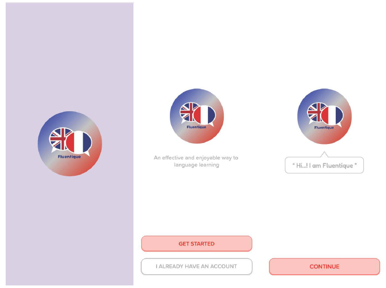
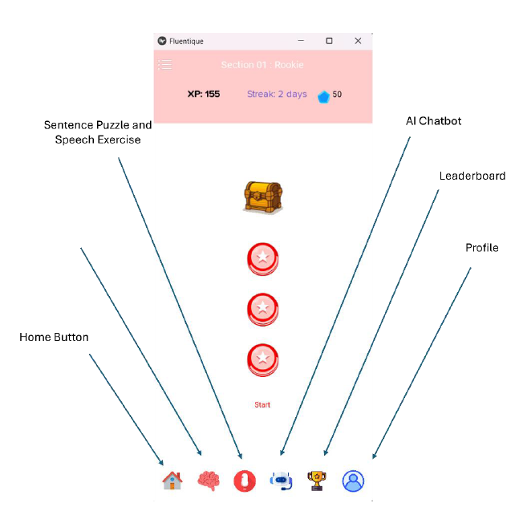
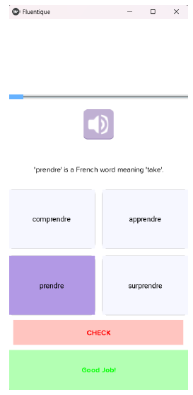
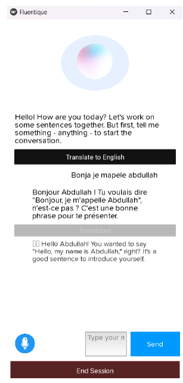
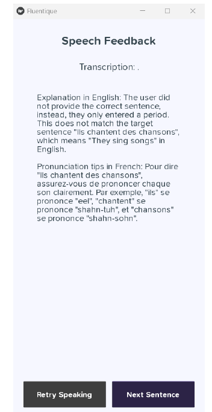
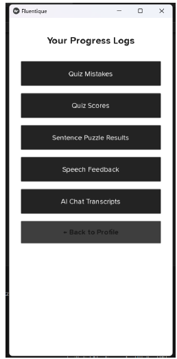

# Fluentique

**Fluentique** is an AI-powered English-to-French language-learning application developed as my university final year project.

The application combines vocabulary practice, grammar exercises, speech recognition, pronunciation feedback, conversational AI, text-to-speech, gamification, progress tracking, and cloud-backed authentication in a Python/Kivy desktop application with a FastAPI backend.

<p align="center">
  
</p>

## Features

- Firebase Authentication for user registration and login
- Vocabulary listening quizzes using curated French exercise data
- Grammar and sentence-building exercises
- French speech transcription using OpenAI
- AI-generated grammar and pronunciation feedback
- Interactive French AI tutor
- French-to-English translation support
- Amazon Polly text-to-speech
- Amazon Translate vocabulary meanings
- XP, streak, league, and leaderboard systems
- User profiles and profile-picture uploads
- Exercise, quiz, speech, and conversation history
- Personalised tutor context based on previous learner mistakes

---

## Application Preview

### Learning Dashboard

Fluentique uses a progression-based home screen to provide access to sentence practice, speech exercises, the AI tutor, leaderboard, profile, and other learning features.

<p align="center">
  
</p>

### Vocabulary Practice

Vocabulary quizzes combine French word recognition, listening practice, answer feedback, definitions, and English meanings.

<p align="center">
  
</p>

### AI French Tutor

The conversational tutor allows learners to practise French naturally while receiving corrections, explanations, translations, and spoken responses.

<p align="center">
  
</p>

### Speech & Pronunciation Feedback

Learners can record themselves speaking French. Fluentique transcribes the recording, compares it with the target sentence, and generates personalised feedback.

<p align="center">
  
</p>

### Learning History

Quiz mistakes, scores, sentence exercises, speech feedback, and AI conversation logs can be reviewed from the application.

<p align="center">
  
</p>

---

## Architecture

The current portfolio version of Fluentique uses a lightweight API-based architecture rather than loading large machine-learning models directly into the application.

### Frontend

- Python
- Kivy
- Requests
- SoundDevice
- SoundFile
- Matplotlib

### Backend

- FastAPI
- Uvicorn
- Firebase Admin SDK

### AI & Language Services

**OpenAI**
- French speech transcription
- grammar correction and explanations
- pronunciation feedback
- conversational tutoring
- AI-driven translation
- tutoring-session summaries

**AWS**
- Amazon Polly for French and English text-to-speech
- Amazon Translate for vocabulary meanings

**Local learning content**
- curated JSON vocabulary datasets
- curated grammar and sentence exercises

### Cloud Services

- Firebase Authentication
- Firebase Firestore
- Firebase Storage
- Amazon Polly
- Amazon Translate

---

## Project Structure

```text
Fluentique/
├── backend/
│   ├── data/
│   ├── routers/
│   ├── services/
│   ├── utils/
│   ├── config.py
│   └── server.py
│
├── docs/
│   └── screenshots/
│
├── experiments/
│   ├── train_grammar_correction_model.py
│   └── train_speech_recognition_model.py
│
├── frontend/
│   ├── assets/
│   ├── kv/
│   └── main_kivy.py
│
├── .env.example
├── .gitignore
├── requirements.txt
└── README.md
```

Runtime-generated or sensitive files are intentionally excluded from version control, including:

```text
.env
secrets/
backend/models/
backend/logs/
logs/
data/progress.json
recorded_audio*
```

---

## Setup

### 1. Clone the repository

```bash
git clone https://github.com/arana1000/Fluentique.git
cd Fluentique
```

### 2. Create a virtual environment

Python **3.10 or 3.11** is recommended.

On Windows:

```bash
python -m venv venv
venv\Scripts\activate
```

### 3. Install dependencies

```bash
pip install -r requirements.txt
```

Some audio functionality also requires **FFmpeg** to be installed and available on the system PATH.

---

## Environment Configuration

Create a `.env` file in the project root using `.env.example` as a template.

```env
# Firebase
FIREBASE_CREDENTIALS=secrets/firebase-admin.json
FIREBASE_WEB_API_KEY=your_firebase_web_api_key
FIREBASE_STORAGE_BUCKET=your_firebase_storage_bucket

# OpenAI
OPENAI_API_KEY=your_openai_api_key
OPENAI_MODEL=gpt-4o-mini
OPENAI_TRANSCRIPTION_MODEL=gpt-4o-mini-transcribe

# AWS
AWS_REGION=eu-west-2
POLLY_VOICE_ID=Celine
POLLY_ENGLISH_VOICE_ID=Amy
POLLY_LANGUAGE_CODE=fr-FR

# Backend / Frontend
CORS_ORIGINS=*
FLUENTIQUE_API_URL=http://127.0.0.1:8000
```

Never commit your real `.env` file or any credentials.

---

## Firebase Configuration

Create a local directory:

```text
secrets/
```

Place the Firebase Admin service-account JSON file inside it:

```text
secrets/
└── firebase-admin.json
```

The location must match the `FIREBASE_CREDENTIALS` value configured in `.env`.

The `secrets/` directory is ignored by Git and service-account credentials should never be committed.

---

## AWS Configuration

Fluentique uses the standard AWS credential chain instead of storing AWS access keys in source code.

Configure credentials locally using:

```bash
aws configure
```

The default region used by the project is:

```text
eu-west-2
```

The configured IAM identity requires access to the AWS services used by Fluentique, including Amazon Polly and Amazon Translate.

---

## Running Fluentique

The backend should be started before the frontend.

### Start the backend

From the project root:

```bash
python -m backend.server
```

Alternatively:

```bash
uvicorn backend.server:app --host 127.0.0.1 --port 8000 --reload
```

### Start the frontend

Open another terminal from the project root:

```bash
python frontend/main_kivy.py
```

If the backend is running at another address, update `FLUENTIQUE_API_URL` in `.env`.

---

## OpenAI API Availability

OpenAI-powered functionality requires a configured API key with available API credits.

If the configured key is invalid, rate-limited, or has exhausted its credits, Fluentique keeps non-OpenAI functionality available and displays a user-friendly service message rather than crashing.

OpenAI API usage may incur charges.

---

## Progress & Runtime Data

During use, Fluentique may create local learning-history data such as:

- quiz results
- grammar mistakes
- speech feedback
- AI chat transcripts
- local progress cache data

These runtime files are intentionally excluded from Git.

Firebase is used for persistent account-related information such as authentication, XP, streak and league information, user profiles, and profile-picture storage.

---

## Original Machine-Learning Experiments

The original university project also explored locally trained and fine-tuned machine-learning approaches for:

- French grammar correction
- French speech recognition

The original experimentation code is preserved under:

```text
experiments/
```

These files document the research and development work carried out during the final year project, but they are **not part of the current runtime architecture**.

The portfolio version moved runtime inference to cloud APIs to make Fluentique significantly easier to run, maintain, review, and deploy without requiring large local model downloads.

As a result, the current runtime does not require PyTorch, Hugging Face Transformers, local Wav2Vec2 model downloads, or Google Speech-to-Text credentials.

---

## Security

Fluentique keeps sensitive credentials and generated runtime files outside version control.

The repository's `.gitignore` protects files including:

- real `.env` files
- Firebase service-account credentials
- AWS credential exports
- downloaded/local model directories
- runtime logs
- local progress data
- recorded user audio
- Python virtual environments
- Python cache files

`.env.example` contains configuration placeholders only.

Credentials that have previously been exposed should always be revoked or rotated rather than simply deleted from source control.

---

## Background

Fluentique was created as my Computer Science (Artificial Intelligence) final year project.

The project explores how artificial intelligence, speech technology, cloud services, personalised feedback, and gamification can be combined into an interactive language-learning application.

The original academic project included experimentation with locally trained machine-learning models. The current portfolio version preserves that work separately while using a cleaner production architecture built around **Python, Kivy, FastAPI, OpenAI, AWS, Firebase, and curated learning datasets**.

---

## Tech Stack

`Python` · `Kivy` · `FastAPI` · `OpenAI` · `AWS` · `Firebase` · `REST APIs` · `Speech Recognition` · `NLP`